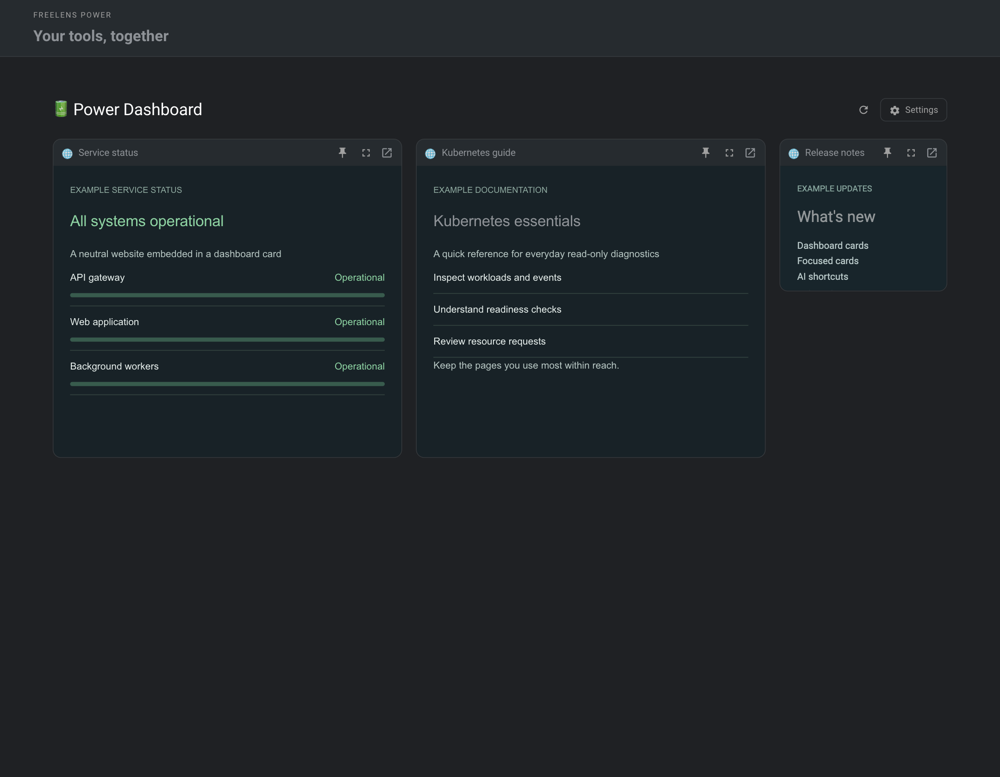
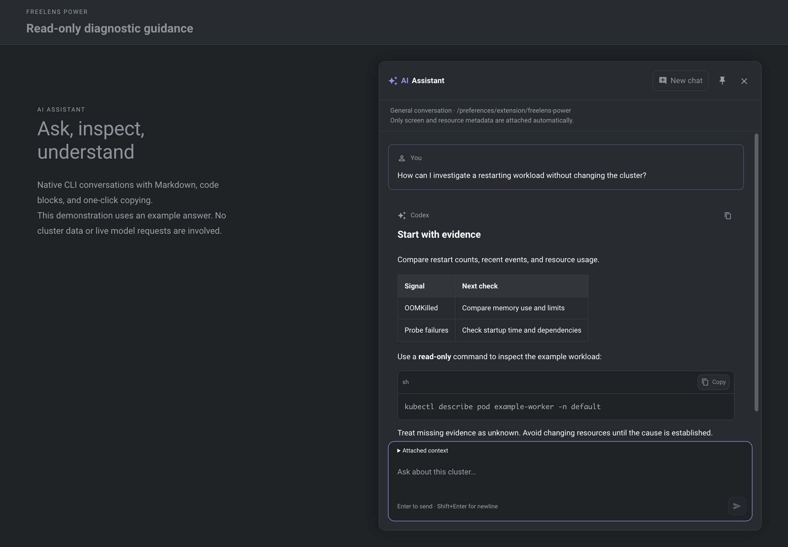
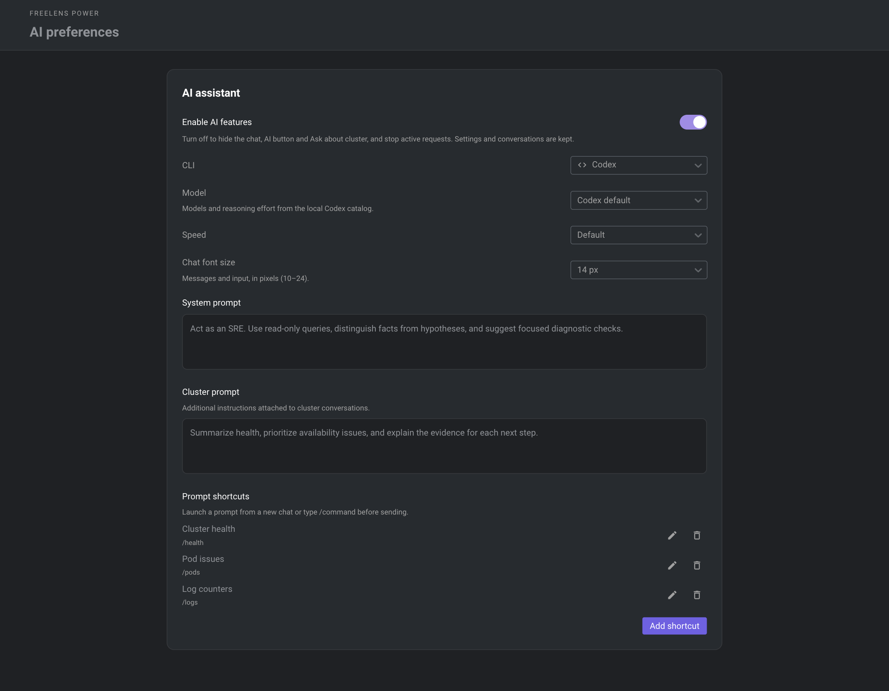
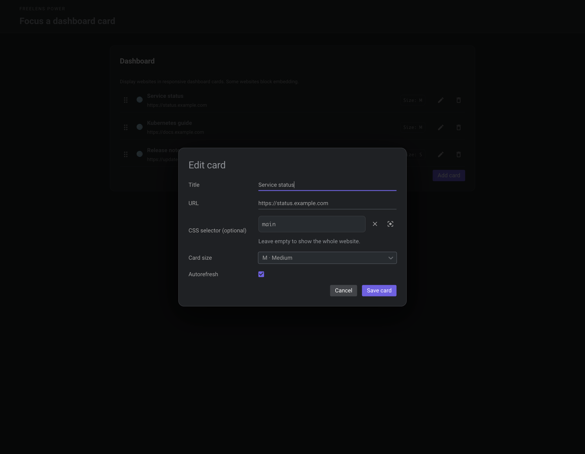
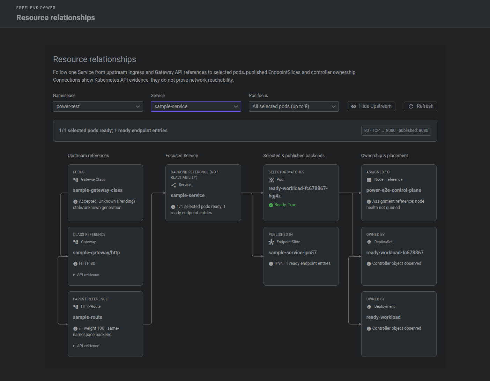
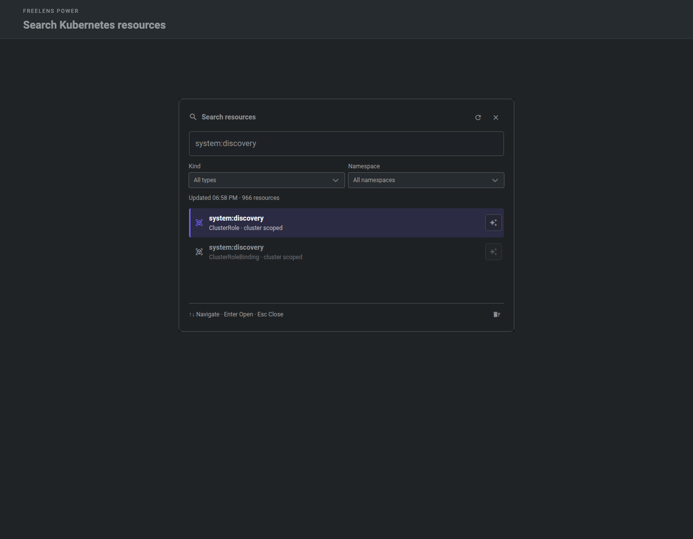
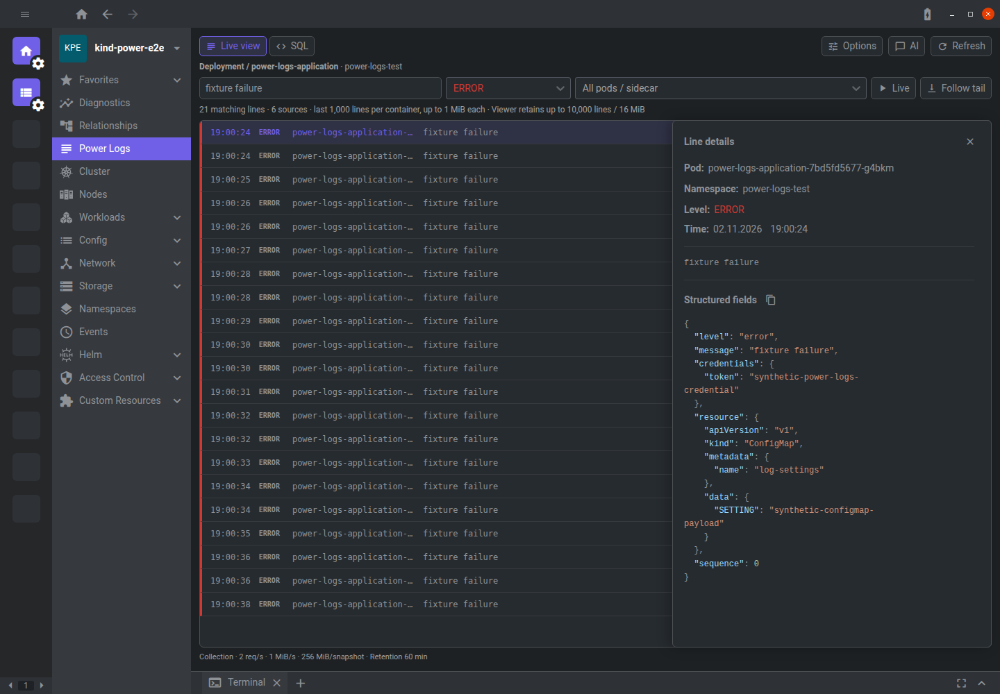
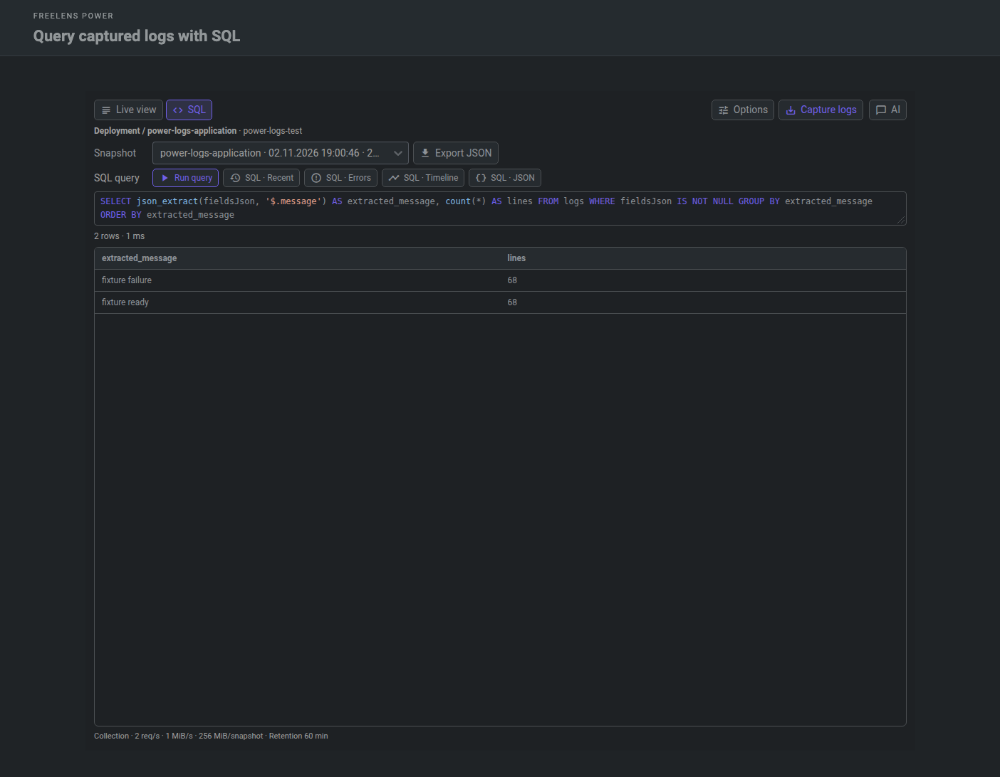
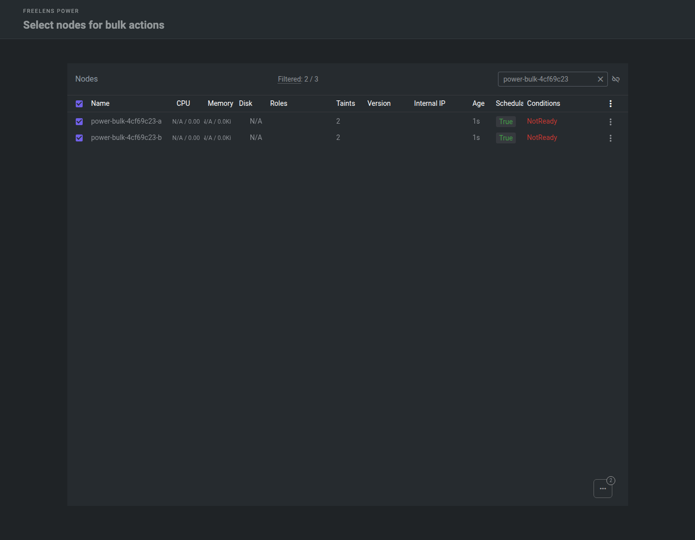

# 🔋 Freelens Power

Power tools and personal dashboards for Freelens. Built for Freelens 1.x and tested with 1.10.3.

## Install

**Installation**

- Open Freelens **Extensions** (`Cmd+Shift+E` on macOS) and install `@64mb/freelens-power` from npm
- Alternatively, install a `.tgz` from [GitHub Releases](https://github.com/64mb/freelens-power/releases) by its absolute path, or build and pack locally

**Updates**

- Click **Update** on the Power entry or use an update notification to open the native installer and confirm replacement
- Disable automatic checks below **Enable Freelens Power** in preferences
- After updating, use **Restart Freelens** in the notification when convenient

## Screenshots

Real extension components with synthetic websites, prompts, conversations, and disposable Kubernetes fixtures. Click an image to open it at full size.

<table>
  <tr>
    <td align="center"><strong>Dashboard</strong><br><a href="https://raw.githubusercontent.com/64mb/freelens-power/main/docs/screenshots/dashboard.png"></a></td>
    <td align="center"><strong>AI assistant</strong><br><a href="https://raw.githubusercontent.com/64mb/freelens-power/main/docs/screenshots/ai-chat.png"></a></td>
    <td align="center"><strong>AI preferences</strong><br><a href="https://raw.githubusercontent.com/64mb/freelens-power/main/docs/screenshots/ai-settings.png"></a></td>
  </tr>
  <tr>
    <td align="center"><strong>Focused website cards</strong><br><a href="https://raw.githubusercontent.com/64mb/freelens-power/main/docs/screenshots/card-editor.png"></a></td>
    <td align="center"><strong>Resource relationships</strong><br><a href="https://raw.githubusercontent.com/64mb/freelens-power/main/docs/screenshots/relationships.png"></a></td>
    <td align="center"><strong>Resource search</strong><br><a href="https://raw.githubusercontent.com/64mb/freelens-power/main/docs/screenshots/resource-search.png"></a></td>
  </tr>
  <tr>
    <td align="center"><strong>Power Logs</strong><br><a href="https://raw.githubusercontent.com/64mb/freelens-power/main/docs/screenshots/power-logs.png"></a></td>
    <td align="center"><strong>Log snapshots and SQL</strong><br><a href="https://raw.githubusercontent.com/64mb/freelens-power/main/docs/screenshots/power-logs-sql.png"></a></td>
    <td align="center"><strong>Bulk node actions</strong><br><a href="https://raw.githubusercontent.com/64mb/freelens-power/main/docs/screenshots/node-bulk-selection.png"></a></td>
  </tr>
</table>

## Features

- 🔐 **Secure Node Shell:** custom connection commands, optional IPv6 preference, and automatic `colima ssh`
- 📜 **Secret certificates:** PEM chain identities, issuers, serial numbers, validity dates, and expiration details
- 🎨 **Accent themes:** eight colors for controls, links, and the welcome logo
- 🏷️ **Cluster icons:** searchable grid, SVG icons, editable labels and colors, and live previews
- 🧩 **Power Dashboard:** reorderable website cards, focused page elements, shared sessions, pinned windows, and optional automatic refresh
- 📈 **Monitoring:** CPU and memory trends, allocation rings, pinned tooltips, and node/pod charts
- 🩺 **Resource diagnostics:** resource consumers, warning timelines, Pending/readiness triage, Service/HPA checks, and incident summaries
- ⚓ **Helm:** fast release lists, revision history, YAML comparisons, background rollback, and confirmed values editing and deletion
- 🖥️ **Nodes:** native table selection, confirmed bulk cordon/uncordon, and sequential drain respecting disruption budgets
- 📋 **Power Logs:** colored workload logs, structured fields, source/level filters, local snapshots, read-only SQL, NDJSON export, and reviewable AI context
- 🔗 **Resource relationships:** Service graphs connecting Ingress and Gateway API routes to pods, endpoints, owners, and nodes
- 🔎 **Fast resource search:** double Shift, local metadata indexing, type/namespace filters, typo matching, resource links, and explicit AI attachments
- 🗄️ **Local metric history:** optional SQLite storage, seven-day history within 100 MiB, aggregated ranges, and visible collection gaps
- 🤖 **AI assistant:** Codex, Claude, or Pi CLI, per-cluster chats, model controls, editable shortcuts, read-only resource discovery, attachments, and pinned chat
- 🛡️ **Read-only UI:** hides common mutation actions without changing Kubernetes permissions
- 🪟 **Interface:** reclaims the bottom status bar space; the master switch restores the native interface and preserves settings
- ⚙️ **Settings:** native switches, compact dashboard editors, and JSON backup/restore of cards and prompt shortcuts
- 🍎 **macOS Dock icon:** follows your accent, with a separate restore toggle

---

AI context can include resource identities, specifications, environment literals, and bounded logs. Recognized Secret/ConfigMap payloads and last-applied annotations are masked while keys remain visible; copies in free text may remain. Review attachments before sending. Terminal output requires explicit attachment; sent attachments stay in local history. AI SQL drafts never run automatically. Dashboard websites use isolated Electron views.

Power Logs snapshots stay local, expire after one hour by default, and share a 1 GiB budget. Pinning preserves snapshots across restarts; stopping Power Logs removes unpinned captures. Settings provide retention, capture limits, storage usage, and confirmed cleanup. Writes stop when storage is full. Collection respects Kubernetes permissions; bounded tails can leave gaps. Native Pod logs remain available.

Metric history requires an active cluster view and cannot backfill gaps. Timelines combine retained events with observed changes; Pending checks explain evidence without reproducing the scheduler. Node and Helm mutations require confirmation and respect read-only/context guards. Helm values editing requires the complete installed chart or its exact repository version; the native Helm view remains accessible.

## Develop

Requires Node.js 24.15.0 and pnpm 10.34.4.

```sh
pnpm install --frozen-lockfile
pnpm build
pnpm test
pnpm lint:check
pnpm pack
```

Use `pnpm dev` to rebuild on changes, then reinstall the package.

## CI and releases

Pull requests and pushes to `main` run independent lint, type checking, unit tests, build and real Freelens UI checks against a disposable kind cluster. Scheduled checks add a light/narrow profile, restart and index refresh scenarios. See [UI testing](e2e/README.md) for fixtures, screenshots and coverage limits.

Run **Make Release** in GitHub Actions to create a version bump pull request. Merging it publishes the package to npm and the installable `.tgz` archive in [GitHub Releases](https://github.com/64mb/freelens-power/releases). Use **Package Release** with the merged pull request number to retry a failed release.

PR titles follow Conventional Commits, for example `feat(ai): add Claude CLI`.

## License

Apache-2.0. Original Freelens template code retains its MIT license and attribution in `THIRD_PARTY_LICENSES`.

[GitHub](https://github.com/64mb/freelens-power)
