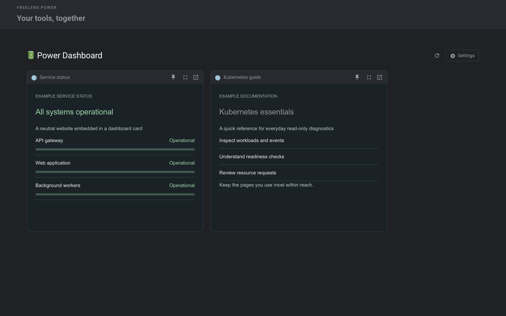
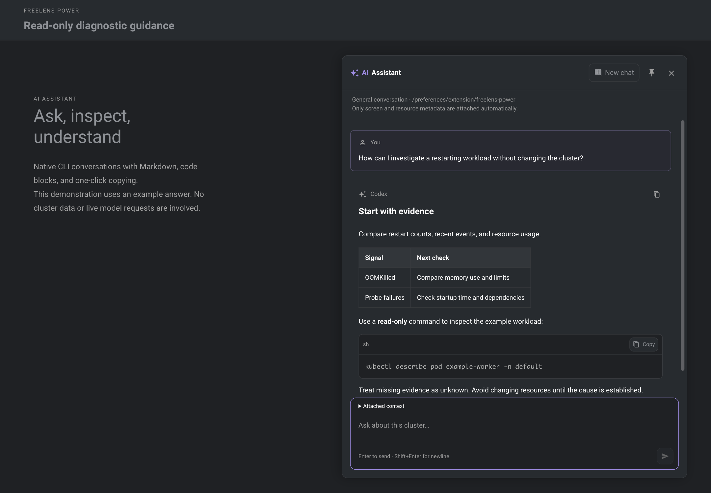
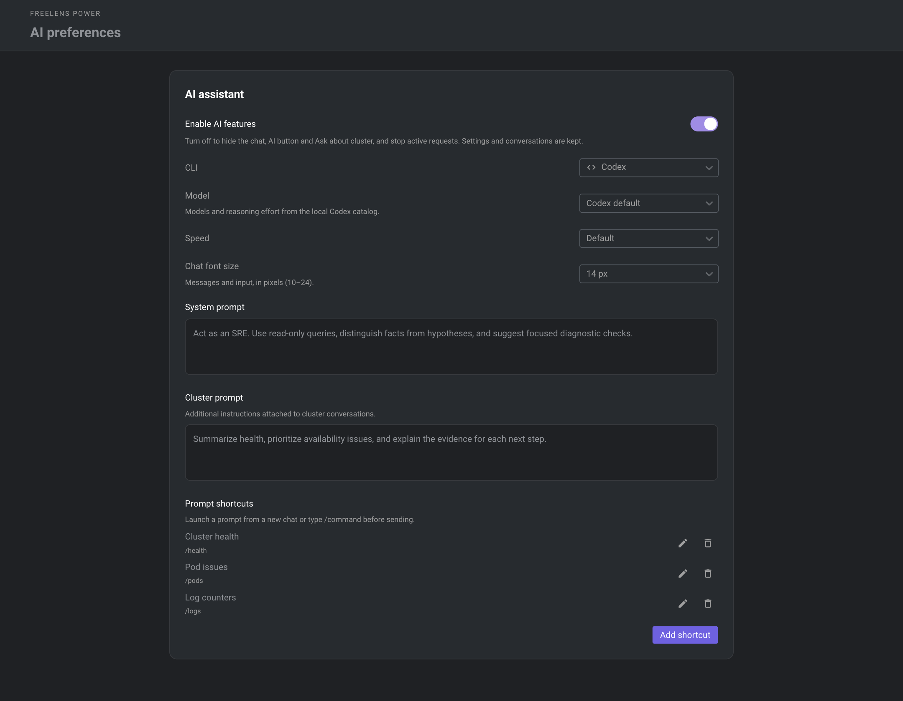
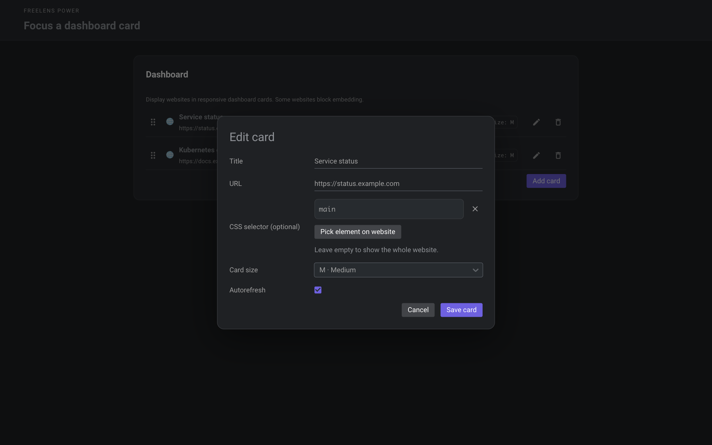

# 🔋 Freelens Power

Power tools and personal dashboards for Freelens. Built for Freelens 1.x and tested with 1.10.3.

## Features

- **Secure Node Shell:** your connection command, optional IPv6 preference, and automatic `colima ssh`
- **Secret certificates:** CN, SAN, issuer, serial number, validity dates, and expiration details for PEM chains
- **Accent themes:** Default, Purple, Blue, Green, Yellow, Orange, Red, and Pink for controls, text links, and the welcome logo
- **macOS Dock icon:** optionally follows your accent, with a separate toggle to restore the original
- **Power Dashboard:** reorderable S/M/L website cards, cached pages, interactive element selection, expansion, pinned floating windows, shared website sessions, and optional background refresh
- **Monitoring:** optional CPU and memory charts using metrics-server, with locally collected session samples
- **AI assistant:** native Codex or Claude CLI, per-cluster conversations, read-only API discovery and resource summaries, model/effort/speed selection, editable prompts, quick-start commands, Markdown, cancellable replies, context preview, resource links, resizable pinned chat, and a switch to disable all AI features
- **Read-only UI:** hides common mutation actions without changing Kubernetes permissions
- **Master switch:** restores the native interface while preserving all settings
- **Settings:** native switches, compact dashboard editors, and JSON backup and restore of cards and prompt shortcuts

AI tool results exclude environment values and Secret payloads; logs are reduced locally to numeric issue counters. Websites run in isolated Electron views. Every dashboard card also opens in your browser.

## Screenshots

Real extension components with synthetic website content, prompts, and conversations.

| Dashboard | AI assistant |
| --- | --- |
| <a href="docs/screenshots/dashboard.png"></a> | <a href="docs/screenshots/ai-chat.png"></a> |

| AI preferences and shortcuts | Focused website cards |
| --- | --- |
| <a href="docs/screenshots/ai-settings.png"></a> | <a href="docs/screenshots/card-editor.png"></a> |

## Install

Install `@64mb/freelens-power` from the npm registry in Freelens Extensions, or download the `.tgz` package from [GitHub Releases](https://github.com/64mb/freelens-power/releases), open **Extensions** in Freelens (`Cmd+Shift+E` on macOS), and install it by its absolute path. You can also build and pack the extension locally.

## Develop

Requires Node.js 24.15.0 and pnpm 10.34.4.

```sh
pnpm install --frozen-lockfile
pnpm build
pnpm test
pnpm lint:check
pnpm pack
```

Use `pnpm dev` to rebuild on changes, then reinstall the package.

## CI and releases

Pull requests and pushes to `main` run lint, type checking, unit tests, and a build.

Run **Make Release** in GitHub Actions to create a version bump pull request. Merging it publishes the package to npm and the installable `.tgz` archive in [GitHub Releases](https://github.com/64mb/freelens-power/releases). Use **Package Release** with the merged pull request number to retry a failed release.

PR titles follow Conventional Commits, for example `feat(ai): add Claude CLI`.

## License

Apache-2.0. Original Freelens template code retains its MIT license and attribution in `THIRD_PARTY_LICENSES`.

[GitHub](https://github.com/64mb/freelens-power)
